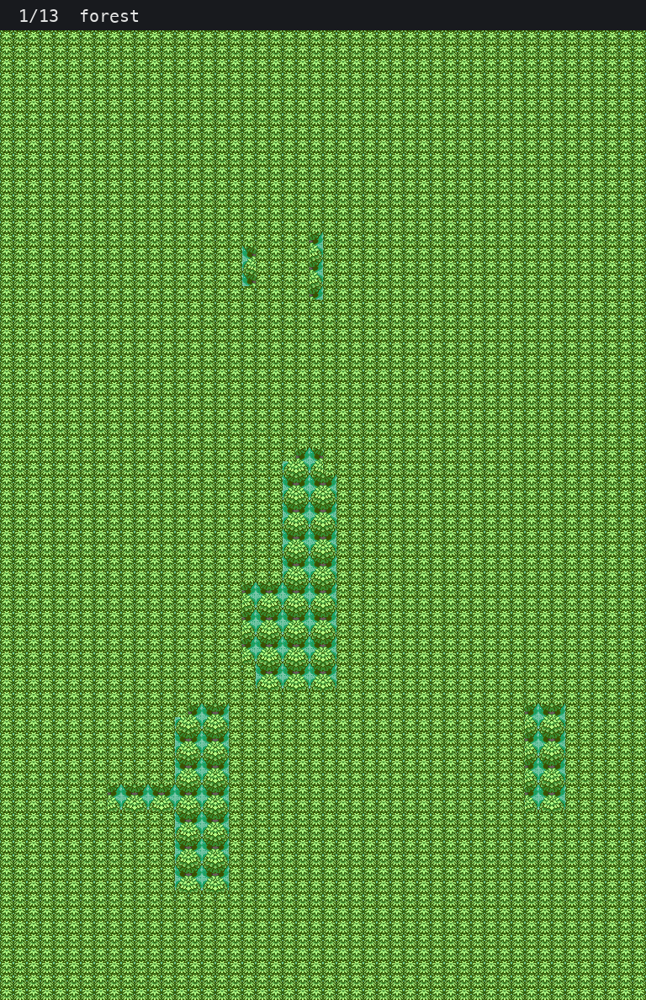
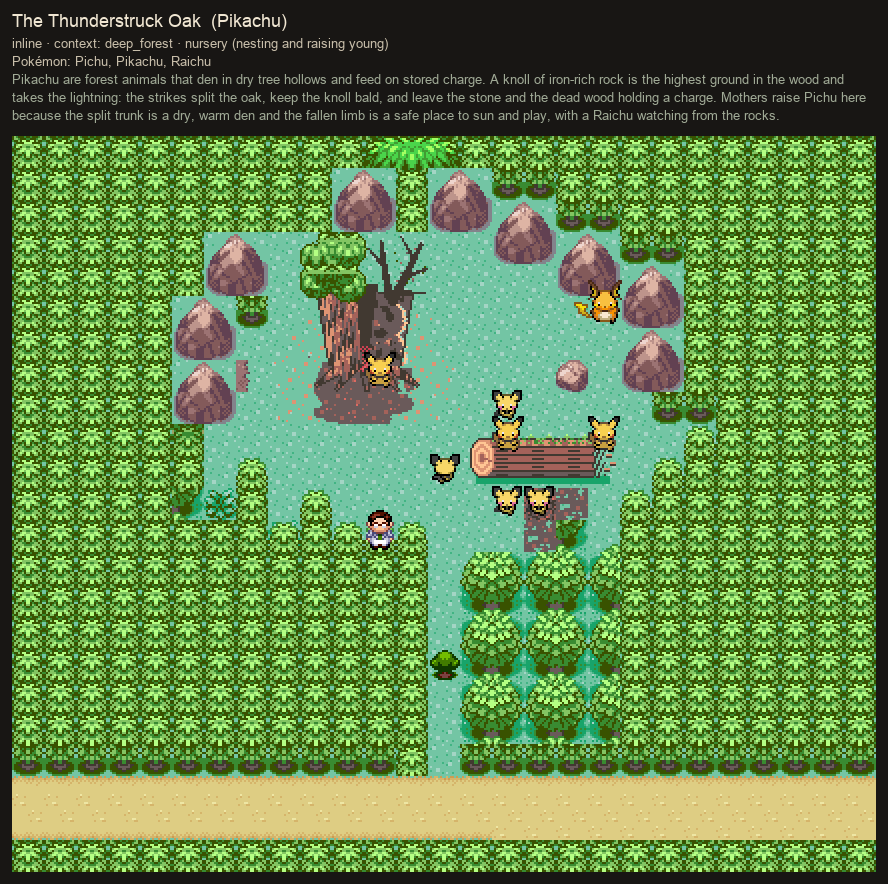
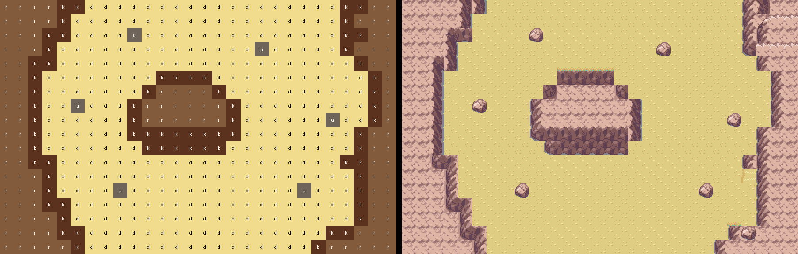
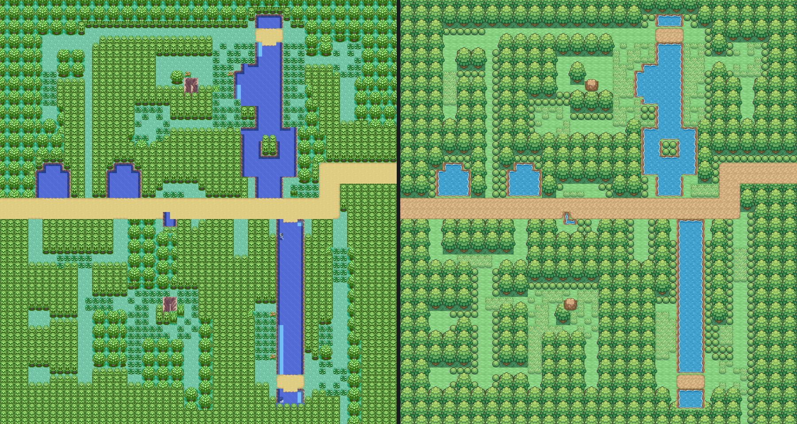
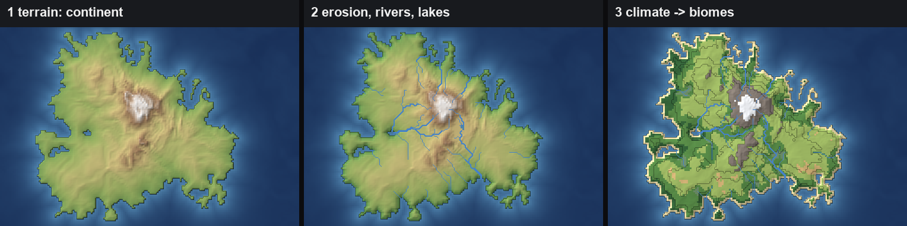
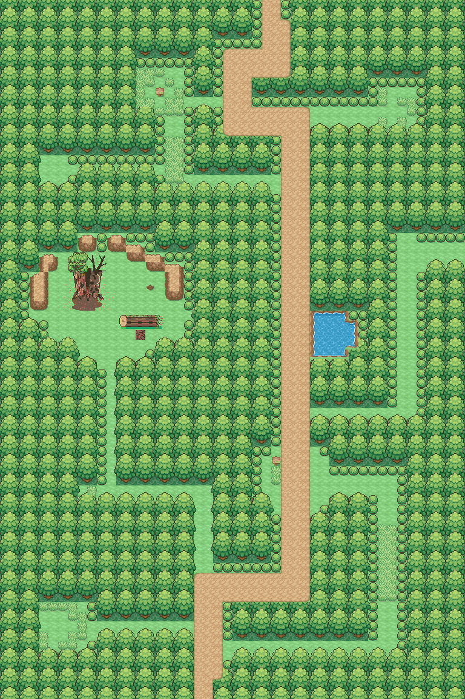
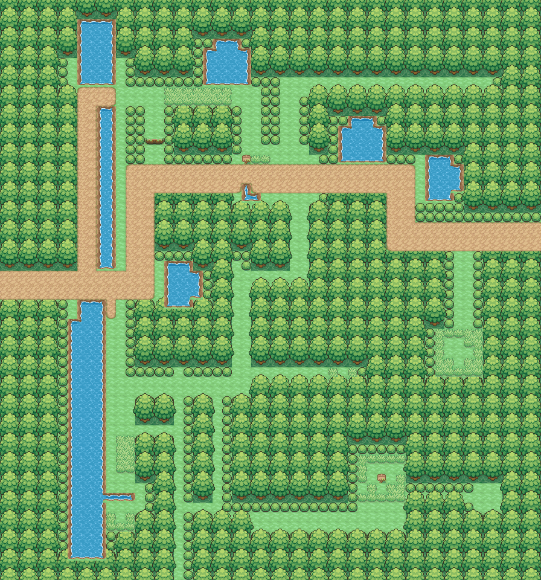
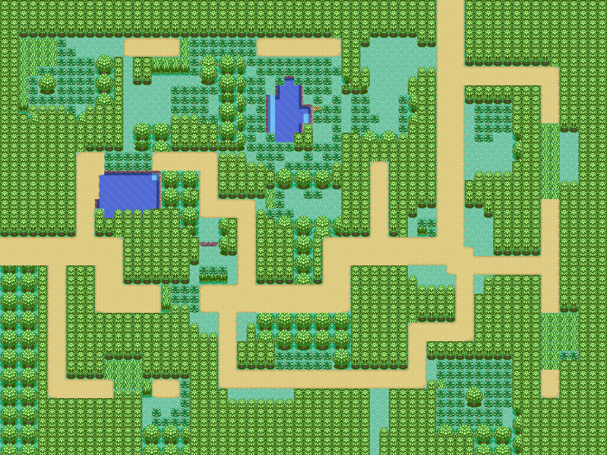
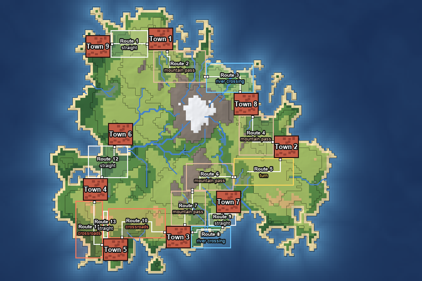

# poke-routes

Generates Pokémon Emerald routes from a short YAML file and writes them out as maps you can open in Porymap and build into pokeemerald or pokeemerald-expansion.

<p align="center">
  
</p>

The routes are meant to feel like Game Freak's: a line with braids in it, with a dirt road you can follow and side lanes that split off and rejoin. Turns are long straight runs, so the map is easy to walk with a d-pad. Most of the interesting places are off the main road, behind a cut tree or a gap in the hedge.

It started as the route generator for Arklarna, a ROM hack, and most of the example output comes from there.

## How it works

A route is built in stages, and each stage edits the same grid of terrain classes (tree, grass, road, tall grass, water, rock, ledge, and a few more). The GIF above is those stages played back.

1. The skeleton is planned first (`braid.py`). The main lane runs from the entry exit to the far exit, with nodes along it. Between two nodes, up to two side lanes split off and run alongside. Each one rejoins at the next node, merges early, or stops short. The road only bends where it has to, and a bend gets a pond where the road would have run straight on. Everything else is forest by default, with a fixed gap of trees between unrelated lanes.
   Every side lane gets a purpose (`purpose.py`): a woodcutters' camp, berry bushes, a shrine, a pond with a fisherman, a ruin, a hunter's blind, a lookout at the wood's edge, a tall-grass track, a shortcut. The purpose is written to the zone meta and `purposes` in scene.json, shows up as an NPC, sign or props, and is what the signpost at the split says.
2. Stages carve that plan into the grid (`stages.py`, `generate.py`): branches, clearings, special areas, water, the road on the critical path, tall grass, ledges, hidden trails, then dressing. Dressing places signposts, HM obstacles on optional lanes (cut trees, smashable rocks, Strength boulders), lore spots, NPCs and items. Height comes from one world height map (`height.py`), sampled where the route sits (`world: [x, y]` in the spec, the region origin, or a spot picked from the seed), so neighbouring routes share their hills. The world tilts gently south because GBA tiles only draw drops that face the camera. Where the ground steps down a tier to the south, a river gets a waterfall and a side lane or clearing gets a ledge, but only if that cuts nothing off; where a full ledge would, it keeps a one-cell gap at one end, so the main road shows the step too and stays two-way. On the mountain the lanes climb on stairs. Riverland now tries for two or three rivers and prefers lines that cross those steps, and adds up to three narrow streams that run south through the trees between lanes, falling at every step they cross. That roughly doubled the waterfalls per riverland route in a 24-route sample; north-south routes, whose rivers run east-west, no longer come out with none.
3. A cleanup pass removes leftovers, and a last pass carves a way to any walkable pocket that can't be reached from the entrance. The same pass looks for ledges that drop into a pocket with no way back to an exit (a field boxed in by hedges, say) and turns them into plain grass, so you can't get stuck. Water that no 2x2 block covers becomes grass too, since neither tileset has art for 1-wide water.

Forest, meadow and riverland are the tested biomes. Beach, desert, mountain and volcanic run but are still rough.

### Special areas

Special areas (`pokeroutes/areas/`) are small composed places dropped into a route, each tied to a Pokémon and to a habitat that makes sense for it. They are rare: an `auto` entry only becomes an area with `special_area_chance` (default 0.35), and `region` allows about one per 2.5 routes (`--special-budget`). The planner puts each one at least 20 tiles from every exit, outside the GBA camera window (15x10) from every point of the main road, and away from other lanes, so the only way in is a hidden trail behind a cut tree, a Strength boulder or an NPC you have to go round. If there is no such site the route has none. The Pokémon stand in the overworld (pokeemerald-expansion's species object events), and you can talk to them and battle them.

<p align="center">
  
</p>

The Thunderstruck Oak is a Pikachu nursery under an oak that lightning split open. Pichu play on the fallen limb while a Raichu watches from the rocks. The areas come from recipes and a regional Pokédex. Without a Pokédex file the generator uses a few built-in shapes (grove, meadow, pond, hollow, standing stones).

### Tiling

The generator only produces terrain classes. Two tilers turn them into metatiles:

- The learned autotiler (`learn.py`, `autotile.py`, `classify.py`) was trained on the 238 Emerald layouts that use the General primary tileset. For each cell it picks the metatiles real maps use for the same 3x3 neighbourhood, then makes a few passes that nudge neighbours toward pairs found side by side in the original maps. The biomes outside the forest family have their own models, trained on the routes that look like them (Route 111 for desert, Routes 105 to 107 for sea, and so on). The models are listed in `pokeroutes/models/index.json`.
- The rule-based tiler (`ruletile.py`) is for custom tilesets that no map uses yet, so there is nothing to learn from. It reads a class table for the tileset and uses blob masks for edges, 2x2 trees and ledge rows.

<p align="center">
  
</p>

<p align="center">
  
  <br><sub>The same route with the learned tiler on Emerald tiles (left) and the rule tiler on Arklarna's tileset (right).</sub>
</p>

### Regions

`pokeroutes.region` generates a whole region and then a spec for every route in it. It builds terrain with erosion, rivers and lakes, works out climate and biomes, and lays out a route graph between towns. Each route in the graph gets a role (straight, turn, crossroads, loop, dead end, mountain pass, river crossing, coastal, sea), and that role shapes how the route generator builds it.

Until now every seed drew the same map (the owner's Arklarna: a mainland, a strait, a sand spit and a lagoon) with only the proportions changing. The owner asked for any geography, for any hack, so the default is now generic: the seed picks a kind of land (continent, coast, peninsula, two to four islands, archipelago, inland lakes, crescent bay) and then its size, ragged coast, bays, headlands and islets. `--geography KIND` forces one. The generic map has no legendary landmarks and no towns; those are the owner's to place, so a fresh region has no routes until towns are added in the editor (routes are then laid along the shortest tree between them). Arklarna is still there as an opt-in preset, unchanged: `python3 -m pokeroutes.region generate --seed N --preset arklarna`. The kinds still lean on a handful of hand-tuned shapes, so whether they feel different enough over many seeds is still open.

<p align="center">
  
</p>

## Quickstart

You need Python 3.9 or newer and a partial checkout of pret/pokeemerald, which the learned tiler reads tiles and layouts from.

```sh
pip install numpy scipy pillow pyyaml

git clone --filter=blob:none --no-checkout https://github.com/pret/pokeemerald vendor/pokeemerald
cd vendor/pokeemerald
git sparse-checkout set --no-cone /data/layouts /data/tilesets /include/constants /src/data/tilesets
git checkout
cd ../..
```

Generate a route:

```sh
python3 -m pokeroutes generate examples/bernsteinweg.yaml --stages
```

This writes `out/Bernsteinweg/`:

- `emerald/data/layouts/<Id>/` with `map.bin`, `border.bin` and an entry for `layouts.json`, and `emerald/data/maps/<Id>/` with `map.json` and `scripts.inc`, ready to merge into a pokeemerald tree and open in Porymap
- `emerald.png`, the tiled map
- `plan.png` and `stages.png`, the class grid and one panel per stage
- `scene.json` and `report.json`, the zones, events and a reachability summary

Watch it build in the browser:

```sh
python3 webui/server.py      # http://localhost:8790
```

The page is a small editor (menu bar, docked Hierarchy / Scene / Inspector, Console and Timeline at the bottom). It plays the stages back in Emerald tiles and lets you change the spec and export a zip. Its Region tab shows a generated region; click a route there to open it in the generator. See `webui/README.md`.

Generate a region:

```sh
python3 -m pokeroutes.region generate --seed 1   # writes region_out/1/
```

Other commands: `python3 -m pokeroutes learn --biomes` retrains the tiling models, `region` generates several route specs together so special areas don't repeat and exits line up, and `generate --tileset ark` uses the rule tiler (it needs a ROM tree with Arklarna's tileset, set with `ARK_ROM`).

## Examples

A spec is short. Every field has a default, so most specs set only the size, the exits and a few counts:

```yaml
name: Bernsteinweg
size: [48, 72]
seed: 7
biome: forest
exits:
  - {side: south, at: 0.45, width: 2, to: MAP_LITTLEROOT_TOWN}
  - {side: north, at: 0.6, width: 2, to: MAP_ROUTE101}
  - {side: east, at: 0.35, to: MAP_ERLENBRUCH}
meander: 0.7
branches: 4
clearings: 4
lakes: 1
tall_grass: 0.3
hidden_paths: 2
hidden_items: 4
special_areas: [thunderstruck_oak]  # most routes: []
special_area_chance: 0.35            # for "auto" entries
```

The three specs in `examples/` give these routes:

| Bernsteinweg (forest) | Erlenbruch (riverland) | Kiefernheide (meadow) |
| --- | --- | --- |
|  |  |  |

And a region, seed 1:

<p align="center">
  
</p>

## Status

This is a work in progress. The forest routes are the most finished. Other biomes and the cave interiors under special areas are rough. Routes generated from a region now draw the region's rivers (with log bridges where lanes cross), lakes, sea and beach along the coast, and mountain rock, and take their biome and woodland density from the land under them. It is rough: rivers step in straight runs, and side lanes still get flooded where the sea lies. Each press of Generate routes lays a different network. Most of the planned special-area recipes are not written yet.

## License

The code is MIT licensed (see [LICENSE](LICENSE)). No Pokémon tiles, sprites or other art are included. They belong to Nintendo, Game Freak and The Pokémon Company, and the tiler reads them from your own pret/pokeemerald checkout in `vendor/`.
